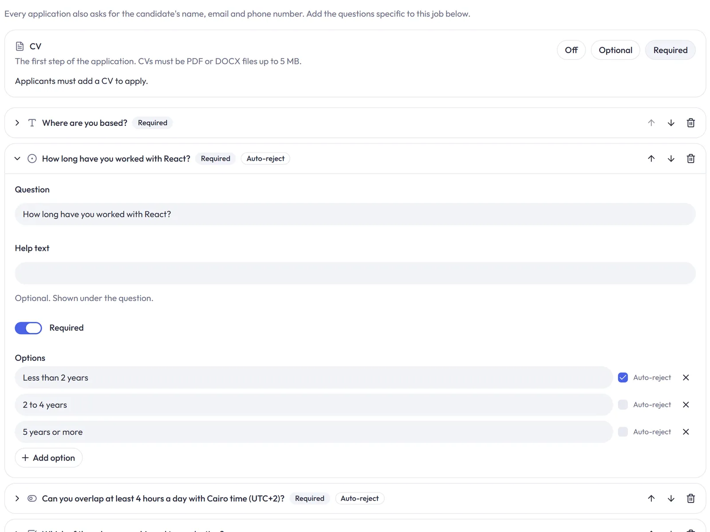
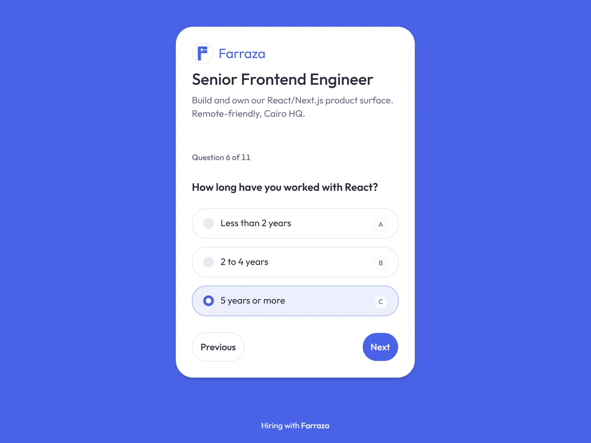
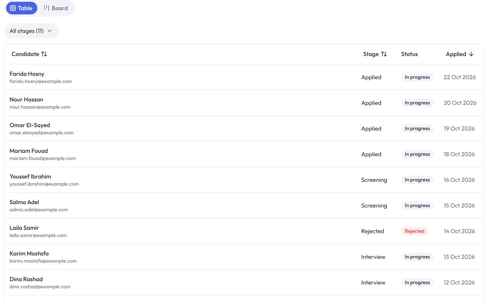
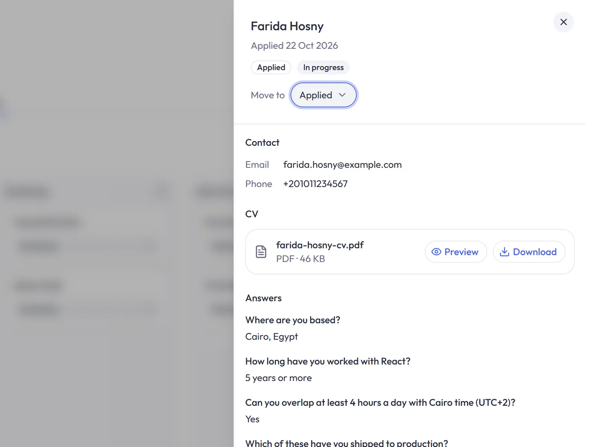

# Farraza

A multi-tenant hiring pipeline (a small ATS). Companies create jobs, build an application form for each job, publish a public apply page, and move applicants through a stage pipeline.

## Stack

- **`apps/api`**: NestJS REST API with Prisma on PostgreSQL
- **`apps/web`**: Next.js (App Router), Tailwind, shadcn
- **`packages/shared`**: Zod schemas and shared logic for form fields and answers
- **`packages/typescript-config`, `packages/eslint-config`**: shared configs

A pnpm + Turborepo monorepo.

## Screenshots

**Build a versioned application form per job**, with optional auto-reject rules on choice questions.



**Applicants answer one question at a time** on a public apply page, on any screen size.



**Track candidates through the pipeline** in a sortable table (or a board).



**Review each application**: contact details, CV preview and download, and answers.



## Getting started

Requires Node 26+, pnpm 12 and Docker.

```sh
pnpm install
docker compose up -d   # Postgres on :5432, S3-compatible storage on :9000
```

Create the env files (the API refuses to boot and lists anything missing):

- `apps/api/.env`: `PORT`, `DATABASE_URL`, `APP_URL`, `INTERNAL_API_SECRET`, `S3_BUCKET`, `S3_ENDPOINT`, `S3_REGION`, `S3_ACCESS_KEY`, `S3_SECRET_KEY`, `GOOGLE_CLIENT_ID`, `GOOGLE_CLIENT_SECRET`
- `apps/web/.env.local`: `API_URL`, `INTERNAL_API_SECRET` (same value as the API's)

Then apply the schema and start everything:

```sh
pnpm --filter api exec prisma db update
pnpm dev               # web on :3000, API on :3001
```

## Commands

```sh
pnpm dev | build | lint | check-types
pnpm format
pnpm --filter api test
pnpm --filter @repo/shared test
```

After editing `apps/api/src/prisma/contract.prisma`, run `pnpm --filter api exec prisma contract emit`.

## More

- [`CLAUDE.md`](CLAUDE.md): architecture notes, conventions, doc references
- [`docs/db-schema.md`](docs/db-schema.md): the database schema
- [`docs/adr/`](docs/adr): architecture decisions
- [`GLOSSARY.md`](GLOSSARY.md): domain terms
